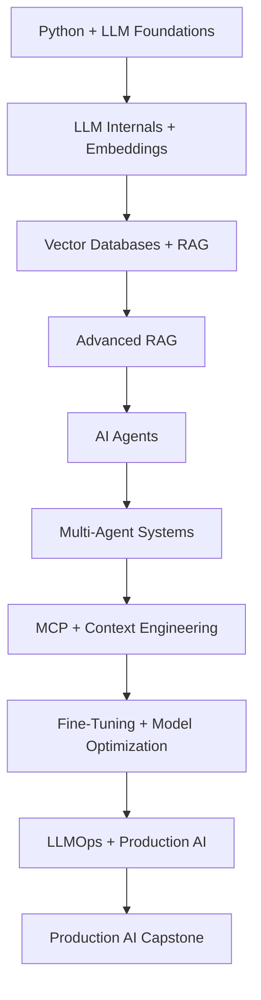

# Learning path

Follow phases in order; use exit criteria and owner review before advancing.

1. [Python + LLM Foundations](phases/phase-01-python-llm-foundations/README.md) — Days 1–7.
2. [LLM Internals + Embeddings](phases/phase-02-llm-internals-embeddings/README.md) — Days 8–14.
3. [Vector Databases + RAG](phases/phase-03-vector-databases-rag/README.md) — Days 15–24.
4. [Advanced RAG](phases/phase-04-advanced-rag/README.md) — Days 25–31.
5. [AI Agents](phases/phase-05-ai-agents/README.md) — Days 32–42.
6. [Multi-Agent Systems](phases/phase-06-multi-agent-systems/README.md) — Days 43–49.
7. [MCP + Context Engineering](phases/phase-07-mcp-context-engineering/README.md) — Days 50–56.
8. [Fine-Tuning + Model Optimization](phases/phase-08-fine-tuning-optimization/README.md) — Days 57–62.
9. [LLMOps + Production AI](phases/phase-09-llmops-production/README.md) — Days 63–69.
10. [Production AI Capstone](phases/phase-10-production-capstone/README.md) — Days 70–75.

## Phase 1 materials

Start with the [seven-day study plan](phases/phase-01-python-llm-foundations/study-plan.md). Phase 1 materials are In Review. Learner completion and implementation remain Planned; Phase 2 requires explicit approval.
