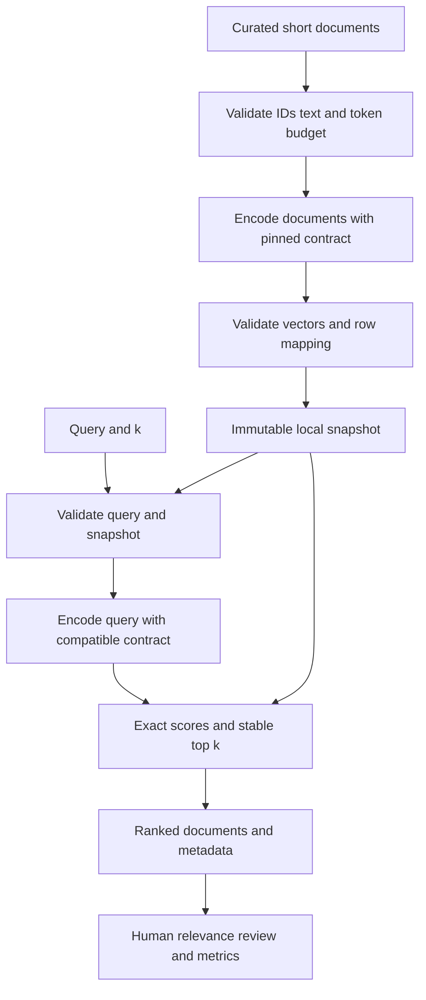

# Phase 2 project — Document Semantic Search

Material status: Approved. Implementation and learner completion: Planned. This is the roadmap’s Day 14 milestone, not a renumbering of the ten portfolio projects.

## Problem statement and business requirements

A user has a small collection of short documents and needs relevant passages even when their question uses different wording. Return ranked documents, their identities, and scores. Do not generate a prose answer, invent citations, browse the web, or call autonomous tools. Demonstrate and evaluate an exact-search baseline before introducing infrastructure.

Mandatory future MVP: a local CLI over 12 short synthetic or licensed English documents. Other languages can be discussed as a failure slice, but broader language support requires a reviewed model and actual evaluation. Keep every document within the chosen encoder input cap; reject over-budget input. Chunking, PDF parsing, Qdrant, pgvector, reranking, hybrid search, agents, LangGraph, and RAG remain later-phase work.

## Prerequisites and technology plan

Phase 1 typing, contracts, settings, errors, tests, and secret hygiene; Phase 2 vector geometry, model selection, and evaluation. A later learner implementation can use Python 3.12+, NumPy, Sentence Transformers, and pytest. Use a local CPU-capable encoder with a reviewed immutable revision; no paid API key or GPU is mandatory. These dependencies have not been added to the course repository.

## Architecture



## Data model and storage schema

No database is required. Specify these local artifacts before implementing them:

- `documents.json`: records with `doc_id`, `title`, `text`, and `source_label`. IDs must be unique, nonempty, and stable. Source labels identify the synthetic fixture or licensed origin; they are not generated URLs.
- `vectors.npy`: numeric float32 `[N,d]` document matrix in the manifest’s exact ID order. Load numeric arrays without object/pickle support.
- `manifest.json`: schema version, snapshot ID, corpus digest, document-ID order, document count, model ID and immutable revision, tokenizer revision, dimension, dtype, normalization, pooling/role policy, and preprocessing version.
- `queries.json`: query ID, text, split, and human-reviewed relevant document IDs. Labels are not inferred from model scores.
- `evaluation.json`: individual rankings, metric definitions, eligible query counts, model/snapshot versions, actual measurements, and separate no-relevant diagnostics.

Write a new generation to a temporary location, validate all cross-file invariants, then activate it. A corrupt or incomplete generation cannot replace the last valid snapshot. Do not mix vectors from unrelated models, even at equal dimensions.

## CLI and optional API contracts

Proposed learner commands, to be implemented later in a separate workspace:

```sh
python -m semantic_search build --corpus data/corpus.json --output artifacts/current
python -m semantic_search query --snapshot artifacts/current --text 'How do I cancel?' --k 3
python -m semantic_search evaluate --snapshot artifacts/current --queries data/queries.json
```

The `semantic_search` package and these executables do not exist in the materials repository.

Build result: snapshot ID, document count, model/revision, corpus digest, and actual build duration. Query input: nonblank text, integer `k` from 1 to 10, and snapshot path. Clamp k to the corpus size and record the actual returned count. Query output: snapshot/model revision, normalization/scoring policy, query latency, and hits containing rank, document ID, score, and a bounded snippet from the matching document. Scores are model-relative similarities, not confidence probabilities.

Errors: invalid input, empty corpus, over-budget text, incompatible manifest, unavailable model artifact, corrupt snapshot, invalid vector, and source-mapping failure. Handle each visibly; never present invalid output as an empty successful search.

Optional future HTTP shape: `POST /v1/search` accepts `query`, `k`, and approved `snapshot_id`; response uses the same result contract. Local file paths are not public API parameters. Authentication, rate limiting, and authorization are prerequisites to exposing a shared service, not capabilities claimed here.

## Proposed learner repository structure

```text
learner-document-search/
  README.md
  pyproject.toml
  src/semantic_search/
    cli.py
    contracts.py
    encoder.py
    snapshots.py
    scoring.py
    evaluation.py
    renderers.py
  data/
    corpus.json
    queries.json
  tests/
    test_scoring.py
    test_snapshots.py
    test_search.py
    test_evaluation.py
  artifacts/
  reports/
```

This is a future implementation plan, not an empty code scaffold to create during course preparation.

## Milestones and step-by-step build guide

1. Freeze 12 short documents, stable IDs, relevance definitions, six development queries, six held-out answerable queries, and two held-out no-relevant diagnostics. Label before examining retrieval output.
2. Implement typed request/result and manifest contracts. Validate text lengths with the actual encoder’s tokenizer and reserve its special-token overhead. Reject duplicates and empty documents.
3. Implement hand-vector scoring first. Reject dimension mismatch, non-finite values, and zero norms. Normalize deliberately and sort descending cosine with document-ID tie-breaking.
4. Implement a thin local encoder adapter with pinned model/tokenizer revisions and documented query/document roles. A fake adapter supports offline application tests but cannot prove real semantic quality.
5. Build document vectors in bounded batches. Preserve exact ID alignment and write/validate an immutable snapshot. Test restart/load behavior before query rendering.
6. Encode a query under the same compatible contract. Return original document text, stable IDs, scores, and snapshot metadata. Do not generate an answer.
7. Add a deterministic token-overlap lexical baseline with stated tokenization/tie rules. Compare on the same corpus and queries; do not call the baseline BM25.
8. Compute hand-checked retrieval metrics and preserve per-query evidence. Tune only on development data, then freeze the policy before held-out evaluation.
9. Document one normal query, one failure, a tie, an exact-identifier query, and a no-relevant query. Include limitations and actual measurement methods.
10. Submit setup instructions, architecture, manifest example, test evidence, evaluation report, and a short demo for review.

## Testing plan

- Arithmetic: identical/orthogonal/opposite/scaled vectors, dot/cosine equivalence under normalization, Euclidean sorting, zero-vector rejection, dimension mismatch, NaN and infinity rejection.
- Snapshots: ID uniqueness, correct row count/order, digest mismatch, incomplete writes, corrupt numeric file, incompatible revision, valid reload, and preservation of a previous generation after a failed build.
- Search: correct descending similarity, stable tie order, valid k with clamping, blank query, empty corpus, correct snippet mapping, and no fabricated document IDs.
- Evaluation: known Recall@k and reciprocal-rank examples, duplicate hit rejection, missing corpus labels, no-relevant queries excluded from recall with a reported count, and fixed eligible-query denominators.
- Integration: deterministic hand-vector encoder plus synthetic corpus for the full build/query/evaluate path. A later local-model smoke test is separate and records download/model revision and actual outputs.

The course currently supplies test specifications, not implemented tests or passing project results.

## Evaluation protocol and rubric

Use development queries to choose policy. Report held-out Recall@1, Recall@3, and MRR across all six answerable held-out queries, with per-query rankings. Keep the two no-relevant queries as a separate diagnostic slice; exact top-k alone does not guarantee abstention. If adding a threshold, create separate development no-relevant examples first and document calibration rather than tuning on held-out failures.

Precision, if included, divides by actual returned positions, with k clamping made explicit. A relevant query with no relevant retrieved document contributes zero to recall and reciprocal rank. No-relevant queries have undefined recall and are counted separately. Show a lexical baseline under the same split and corpus; report failures even when the average improves.

Project-quality review: contract/artifact integrity 25 points; scoring and identity correctness 25; honest evaluation and baseline comparison 25; reproducibility and failure handling 15; clarity/security/limitations 10. This 100-point project rubric is separate from the phase assessment’s 10-point submission component.

No minimum held-out retrieval score is claimed or required without a reviewed dataset; a low-quality but honestly measured baseline should trigger analysis, not fabricated success.

## Security and privacy

Use public/synthetic data, inspect model provenance and license, and avoid executing unreviewed model repository code. Model downloads are a network dependency; document the local cache and offline replay path. Text, snippets, embeddings, and retained snapshots inherit source sensitivity. Avoid logging raw private queries or documents. Delete derived vectors and retained artifacts according to the same retention policy as the source. The local project does not implement production multi-tenancy or authorization.

## Execution, deployment, and observability

Local execution is sufficient for the mandatory MVP. Record cold model-load time, document build time, and warm query latency separately with hardware, package versions, repetition counts, and corpus size. Do not report a p95 from a single request. Measure quality independently of speed. Docker, AWS, hosted endpoints, distributed queues, and vector databases are optional later-phase extensions.

## System design trade-offs

Exact scoring is simple and auditable but scales linearly with corpus size. Local snapshots provide reproducibility but need explicit refresh/activation and deletion policy. A compact encoder eases local execution but may fail language or domain requirements. Normalization simplifies cosine comparison but must match model guidance. A richer semantic model may improve paraphrases while exact identifiers still need separate evaluation.

## Completion and demonstration checklist

- [ ] Setup reproducible in the learner workspace with pinned model/package versions.
- [ ] Real document embeddings generated and stored with a validated manifest.
- [ ] Scoring and artifact failure tests pass with recorded evidence.
- [ ] Search returns correct IDs/snippets and stable ranking metadata.
- [ ] Held-out metrics, no-relevant diagnostics, and lexical baseline reported honestly.
- [ ] Normal, tie, incompatible-snapshot, and no-relevant cases demonstrated.
- [ ] Architecture, storage assumptions, source sensitivity, and limitations explained.
- [ ] Owner review recorded; no learner completion claimed merely from prepared materials.
