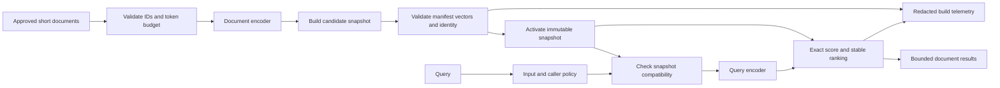

# Case study — Versioned embedding search service

Phase 2 design material: Approved. Implementation and measured service properties: Planned.

## Architecture concepts and scope

Separate expensive corpus encoding from repeatable query scoring. Treat embedding geometry as a versioned interface and publish coherent artifact generations. The mandatory project is single-user/local. The service described here is an interview/design extension, not infrastructure to deploy during this phase.

## Functional requirements

- Accept curated short documents with stable IDs and source labels.
- Reject duplicate IDs, unsupported lengths, corrupt vectors, and incompatible encoder contracts.
- Build an immutable document/vector/manifest snapshot and activate only validated generations.
- Accept a bounded query and k; return ranked authorized document records with scores and version metadata.
- Retain a coherent previous generation for rollback and define deletion/retention behavior.

## Non-functional requirements and proposed targets

- Reproducible model revision, corpus digest, preprocessing, metric, normalization, and tie behavior.
- Warm-query p95 target of 500 ms at 10,000 short documents on a declared machine is a design hypothesis to measure, not an achieved result.
- Explicit limits: document/query token budget, bounded batch size, k from 1 to 10, bounded snippets, and bounded concurrent queries if an API is introduced.
- No secrets or private document bodies in telemetry. Failed builds cannot corrupt an active generation.

## Architecture diagram

## Data flow

1. Freeze document IDs/text and compute the corpus digest.
2. Validate text/token limits and select the pinned model contract.
3. Encode bounded batches with stable row identity.
4. Write an isolated candidate generation and validate all cross-file checks.
5. Activate one complete generation; leave the previous valid generation available for rollback.
6. For each query, select one generation and check model/tokenizer/role compatibility.
7. Encode, score, and sort only the eligible document set, then render bounded results.
8. Record versions, duration, counts, and error class without raw sensitive payloads.

## Storage and API decisions

The local MVP stores JSON metadata and numeric float32 arrays. A manifest binds corpus digest, row order, encoder revision, dtype, dimension, normalization, and preprocessing. A future API uses `POST /v1/search` with query, k, and an approved snapshot ID. Do not accept arbitrary filesystem paths from public callers.

Possible errors: INVALID_INPUT 400, UNAUTHORIZED 401/403, SNAPSHOT_UNAVAILABLE 503, INCOMPATIBLE_CONTRACT 409, and INVALID_ARTIFACT 500. Avoid exposing local paths or raw model exceptions. Artifact validation at startup and immutable generations reduce ambiguous mid-request failures.

## Capacity and scalability analysis

For N=10,000, d=384, and float32, raw vectors need 15,360,000 bytes, about 14.65 MiB. Exact scoring touches roughly N*d components per query. At 10 queries/second, that is approximately 38.4 million scored components per second before encoder and sorting costs; this is arithmetic workload, not a latency or throughput guarantee.

Budget model weights, text metadata, batches, duplicate generations, scratch arrays, and process overhead separately. Batch-size tuning needs measurement on representative lengths. A larger corpus, frequent updates, filtering, durability, and concurrent serving can motivate Phase 3’s vector-store/index discussion. Do not choose infrastructure based on vector bytes alone.

## Security and privacy

Caller identity and eligible corpus selection must precede retrieval in a shared service. Post-filtering top-k can both miss authorized results and mishandle information exposure. This phase does not implement multi-tenant authorization. Keep model provenance, synthetic/licensed data, private-query logging, model downloads, and derived-artifact retention in the threat model. A manifest is an integrity/compatibility aid, not an authorization system or proof of factual relevance.

## Failure scenarios and responses

- Model download unavailable: use a reviewed local artifact cache, or report unavailable; do not silently change the encoder.
- Query/corpus revisions differ: reject before scoring and activate a coordinated generation.
- Interrupted corpus build: discard the candidate and retain the active generation.
- Row-count/order mismatch: fail validation; never join snippets by approximate position.
- NaN or zero vectors: report invalid representation rather than ranking invalid scores.
- Oversized text: reject clearly; silent truncation can remove the only relevant sentence.
- Source deletion: rebuild or remove records and derived vectors, and expire retained snapshots under the documented policy.
- Resource saturation: bound concurrency and batch memory; do not retry local out-of-memory failures in an unbounded loop.

## Observability and measurement plan

Record build duration/document count, model-load duration, warm query encode/score/render durations, error classes, snapshot ID, model revision, and selected k. Report repetitions and hardware. Pair latency observations with labeled retrieval quality; “fast” irrelevant results are still a failure. Protect query/document contents and use synthetic examples in demonstrations.

## Architecture trade-offs

Exact search is a transparent baseline with linear scoring cost. Immutable local snapshots simplify reproducibility but consume extra storage during rebuilds and complicate deletion retention. In-memory arrays reduce read overhead but add process memory and startup cost. Precomputing vectors reduces repeated encoding but requires cache invalidation when source text or model policy changes. Automatic model fallback can invalidate geometry; fail visibly instead.

## Interview exercise

You have 100,000 short documents, five updates per minute, and 50 queries/second. State text-length, language, hardware, freshness, and privacy assumptions. Estimate vector storage and exact-scoring workload, then propose what to measure before selecting an index or vector service. Explain activation, rollback, query/corpus compatibility, deletion, and three failure scenarios. A diagram alone does not justify a scale claim.

## Submission and review rubric

Submit the diagram, capacity arithmetic, measurement plan, interface/storage contracts, failure table, privacy policy, and alternatives. Review whether every target is labeled as measured or proposed, every artifact has an owner/version, and failed updates preserve coherent query behavior.
