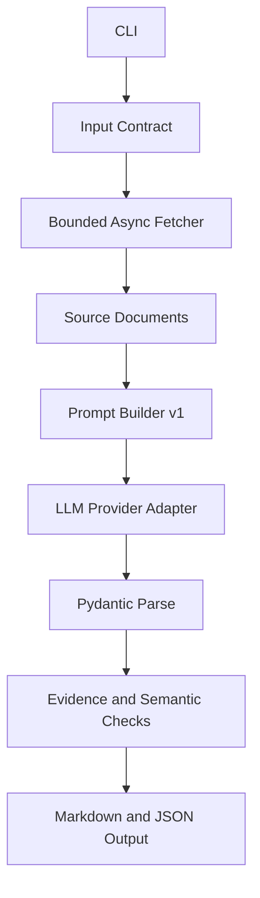

# AI Research Assistant — Phase 1 specification

Status: In Review (specification). Implementation: Planned.

[Phase 1](../../phases/phase-01-python-llm-foundations/README.md) · [Project overview](README.md)

## Project specification

Build a CLI application that accepts a company and 2–5 user-approved source URLs, fetches them safely, and produces a validated brief containing:

- company overview;
- industry;
- products;
- competitors;
- recent developments;
- concise summary;
- source records that state which sections each URL supports;
- warnings for missing, conflicting, stale, or inaccessible evidence.

The MVP does **not** independently discover the whole web, claim exhaustive research, use embeddings/RAG, or run an autonomous agent loop.

## Architecture



## Technology stack

- Python 3.12+, OpenAI Python SDK or compatible provider adapter.
- HTTPX, Pydantic v2, pydantic-settings, pytest, pytest-asyncio.
- Standard-library logging, `Decimal`, `pathlib`, and `asyncio`.
- Optional production extension: FastAPI, PostgreSQL, queue, secret manager—do not add these to the mandatory seven-day MVP.

## Repository structure

```text
ai-research-assistant/
├── pyproject.toml
├── .env.example
├── README.md
├── src/research_assistant/
│   ├── cli.py
│   ├── config.py
│   ├── domain.py
│   ├── fetcher.py
│   ├── prompts.py
│   ├── provider.py
│   ├── service.py
│   ├── validators.py
│   └── renderers.py
├── tests/
│   ├── fixtures/
│   ├── test_fetcher.py
│   ├── test_service.py
│   ├── test_validators.py
│   └── test_cli.py
└── outputs/
```

## Milestones and build guide

1. **Bootstrap:** package, settings, `.env.example`, lint/test commands, secret-safe Git setup.
2. **Contracts:** `ResearchRequest`, `SourceDocument`, `SourceRef`, `CompanyBrief`, typed error hierarchy.
3. **Fetcher:** HTTPS validation, timeouts, size/type limits, bounded concurrency, explicit failures.
4. **Provider adapter:** real OpenAI implementation and fake deterministic implementation.
5. **Prompt v1:** authority, task, source delimiters, “do not guess,” conflict/uncertainty policy, output schema.
6. **Generation:** request structured output, capture metadata, parse Pydantic result.
7. **Evidence validation:** every non-empty section must have at least one supporting source reference; referenced URLs must come from fetched inputs; duplicates removed.
8. **Render:** machine-readable JSON and human-readable Markdown. Never rewrite invalid output into apparent success.
9. **Tests:** unit tests with fake provider/mock transport; one opt-in integration test requiring a real key.
10. **Documentation/demo:** architecture, setup, design decisions, limitations, sample sanitized output, test evidence.

## Testing and evaluation

- Unit: settings constraints, URL validation, retry classification, schema parsing, source-reference integrity, renderer snapshots.
- Integration: mocked HTTP + fake provider for the full path.
- Opt-in live: one company and approved sources; mark skipped unless `RUN_LIVE_TESTS=1`.
- Evaluation dataset: five cases—well-covered company, conflicting sources, missing recent developments, inaccessible URL, prompt injection in source text.
- Rubric: contract validity 20; evidence discipline 30; source-consistent correctness 25; uncertainty handling 15; clarity 10. Record scores; do not invent benchmark results.

## Deployment/execution

```bash
python -m venv .venv
source .venv/bin/activate
python -m pip install -e '.[dev]'
pytest -q
research-assistant Acme \
  --source https://example.com/about \
  --source https://example.com/news
```

For Phase 1, local execution is sufficient. Docker/AWS production deployment belongs to Phase 9; the README should note the future path without implementing it prematurely.

## Completion criteria

- Clean setup from README in under 10 minutes.
- All non-live tests pass.
- Live run returns validated JSON and Markdown or a typed, visible failure.
- No fabricated source URLs; every reference is one of the supplied/fetched URLs.
- Missing/conflicting evidence becomes a warning, not invented certainty.
- Model, prompt, and schema versions plus latency/request ID are recorded.
- Git history shows incremental milestones; repository contains no key or private source content.

## Demo checklist

- Show a normal request.
- Show a source-fetch failure that produces a warning or typed failure.
- Show an injected source instruction being ignored.
- Show invalid fake-model output failing Pydantic validation.
- Explain architecture, provider trade-offs, retry policy, evidence limits, cost/latency measurements, and what changes in RAG phases.

## Business requirements and boundaries

A user needs a traceable brief from 2–5 explicitly approved URLs. The brief must show evidence gaps and failures. Reference integrity does not prove that a cited page supports a claim; human review remains necessary. A model cannot be assumed resistant to prompt injection solely because instructions or delimiters exist.

## Database schema and API design

No database is required. Save local JSON and Markdown artifacts with request, model, prompt, schema, source, and retrieval metadata. The optional HTTP contract is described in the inference-gateway case study. FastAPI, queues, persistent idempotency storage, Docker, and AWS are later extensions.

## Materials-only delivery

The file tree and commands above describe a future learner implementation in a separate workspace. They are not present executables in this repository. No test suite, benchmark, provider run, project completion, or deployment is claimed.
