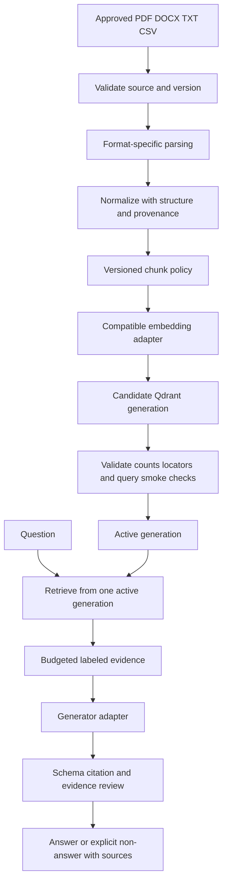

# Enterprise Knowledge Assistant — Phase 3 specification

Material status: In Review. Implementation, learner completion, model runs, and project test execution: Planned.

## Problem statement and roadmap/portfolio relationship

A user needs answers from a bounded document collection with inspectable sources. The original Phase 3 milestone is an **Enterprise Knowledge Assistant**. This specification develops the document-knowledge foundation within the existing **Company Knowledge Agent** portfolio folder. The folder name does not imply an agent loop. The later LangGraph/pgvector portfolio design remains a later-phase extension; Phase 3 uses the roadmap’s Qdrant baseline.

## Mandatory business requirements

- Ingest 12 small synthetic/licensed sources: three selectable-text PDFs, three simple DOCX files, three UTF-8 TXT files, and three CSV files with meaningful headers and stable row identifiers.
- Preserve source ID/version, parser/chunker/encoder contracts, chunk identity, and format-appropriate locators.
- Build a compatible Qdrant collection/generation with deterministic supported point IDs and explicit active-version policy.
- Answer a question from retrieved context, show cited source passages/locators, and distinguish answered, insufficient evidence, conflict, and typed error outcomes.
- Provide manual and LangChain paths over equivalent data/contracts, with parity checks before comparing real generated output.
- Record stage evidence and evaluate parsing, retrieval, context coverage, answer support, citation validity, and abstention separately.
- Use only a local single-user corpus in the mandatory MVP. “Enterprise” describes the roadmap use case, not an achieved production-readiness claim.

## Prerequisites and technology plan

Phase 1 typed Python, structured outputs, provider boundaries, prompts, errors, and tests. Phase 2 encoder manifests, vectors, exact search, and evaluation. Planned tools for later implementation: Python 3.12+, qdrant-client, a reviewed local embedding model, Pydantic, LangChain component/integration packages, langchain-text-splitters, Docling, standard-library pathlib/csv, and pytest. Record package, model, and parser asset versions when implementation begins. No dependencies are added now.

A live generation adapter must be chosen/configured during the implementation pass; credentials, model availability, token limits, and cost require account-specific review then. Fake generation supports deterministic contract tests but cannot satisfy live grounding-quality acceptance. No particular provider model or API key is required to study these materials.

## Architecture



## Data model and storage schema

Use a source manifest plus Qdrant payloads; a separate relational database is not mandatory.

- Source record: `doc_id`, format, approved local path/source label, source hash/version, parser version/options, conversion status/warnings, and expected-source membership.
- Normalized block: document/version, text, heading ancestry, format-specific source locator, and parsing-quality status. Keep normalized text separate from arbitrary generated descriptions.
- Chunk record/payload: `chunk_id`, document/version, text, locator(s), section/parent references, chunk policy/version, embedding contract ID, and generation ID.
- Qdrant point: supported deterministic UUID/integer ID, compatible vector, and the declared payload schema. Store user-facing string IDs as payload where needed.
- Generation manifest: complete expected-source set, parser/chunker/encoder versions, collection name, dimension/distance/normalization, corpus digest, chunk counts, failure ledger, and activation status.
- Answer trace: question ID, active generation, retrieved chunk IDs/scores, context label mapping, prompt/schema versions, generator identifier, stage durations, and safe error/warning metadata.

PDF pages must use a stated numbering convention. DOCX uses heading/block or stable paragraph references without invented page numbers. TXT uses line ranges with declared normalization rules. CSV uses row IDs plus header context. Every displayed citation must resolve to the same source version used for retrieval.

## Input, CLI, and optional API contracts

Future learner commands, not executables shipped here:

```sh
python -m knowledge_assistant ingest --manifest data/source-manifest.json --generation corpus-v1
python -m knowledge_assistant ask --generation corpus-v1 --question 'What notice is needed?'
python -m knowledge_assistant evaluate --generation corpus-v1 --queries data/evaluation.json
```

Question input: nonblank bounded text, approved corpus generation, retrieval k, and a declared evidence token budget. Do not accept arbitrary untrusted filesystem paths as a public service API.

Answer output: status (`answered`, `insufficient_evidence`, `conflict`, or typed error), a list of claims with context-label citations, source records with original text/locators, warnings, generation/model/prompt/schema IDs, and timing/usage when actually available. Every answered claim needs at least one supplied source label. Unknown labels fail structural validation; factual support needs separate evaluation.

`insufficient_evidence` means retrieval/context cannot support the answer, not that a provider timed out. Provider failures remain errors. A `conflict` result must show conflicting source evidence without silently resolving it as fact. Sources can be stale or wrong even when their IDs/locators are valid.

Optional future endpoint: `POST /v1/answers`. A public service would require authentication, trusted authorization/scope, request limits, redaction, and a version-selection policy. Those controls are design extensions, not achieved local-MVP capabilities.

## Proposed learner repository structure

```text
learner-knowledge-assistant/
  README.md
  pyproject.toml
  .env.example
  src/knowledge_assistant/
    contracts.py
    source_manifest.py
    parsers.py
    chunking.py
    embeddings.py
    vector_store.py
    ingestion.py
    retrieval.py
    context.py
    generator.py
    answer_validation.py
    langchain_adapter.py
    cli.py
  data/sources/
  data/source-manifest.json
  data/evaluation.json
  tests/
  artifacts/
  reports/
```

This tree is a future implementation plan. Do not create empty app files as evidence of progress during material authoring.

## Milestones and detailed build guide

1. Freeze the 12-source corpus and gold excerpts/locators. Add separate negative fixtures for corrupt, scanned/empty, or malformed inputs; these are not silently counted among the 12 required valid sources.
2. Define source, normalized-block, chunk, embedding, generation, and answer contracts. Write invalid-input fixtures before choosing frameworks.
3. Start with TXT/CSV adapters and a tiny hand-authored normalized block set. Check headers, quoting, Unicode, line/row identities, and duplicate IDs.
4. Define Docling PDF/DOCX conversion, status/warning handling, structural/provenance retention, and text-first limitations. Inspect expected excerpts before bulk conversion.
5. Compare chunk policies on development examples; select one bounded policy. Validate final encoder tokens including heading/context prefixes. Version all transformations.
6. Reuse a compatible Phase 2 local encoder contract. Build deterministic point IDs and a payload schema in a fresh candidate Qdrant generation; preserve source identity through batching.
7. Validate all 12 expected sources, chunk counts, vector compatibility, locator round trips, and retrieval smoke checks. Only then activate the generation. Optional unsupported negative fixtures remain visible errors/needs-review outside the valid corpus.
8. Implement manual question → retrieval → budgeted labeled context → generator → validated cited answer. Gate empty evidence and distinguish refusal/timeout from lack of source evidence.
9. Add LangChain component wiring using explicitly compatible payload mappings. Compare IDs/text/locators/filter behavior under fixed fixtures and fake generation before real-model runs.
10. Add one Day 23 rewrite/filter/fusion/reranking worksheet and controlled experiment plan. Full advanced retrieval implementations/tuning remain Phase 4, not a mandatory Phase 3 expansion.
11. Run deterministic tests, a later real parsing/embedding smoke test for all four formats, and a later configured real-generation evaluation. Record outputs/versions honestly.
12. Submit setup, architecture, source/chunk manifests, test/evaluation evidence, normal and failed demos, and limitations.

## Test specifications

- Parsing: correct gold excerpts/locators per format; UTF-8 and CSV quoting/header handling; selectable PDF/DOCX structure; unreadable/partial conversion; scanned-image policy; empty source rejection.
- Chunking: deterministic IDs/order, explicit character/token units, final encoder limits, heading/exception boundaries, empty/long text, overlap progress, and repeated evidence deduplication.
- Ingestion: unchanged-source rerun, changed source/policy re-indexing, stale-tail deletion, incomplete writes, incompatible collection/encoder, active-generation isolation, and retained-source deletion policy.
- Retrieval: exact toy-vector comparison, correct document/chunk mapping, explicit payload return, stable application tie rules, filter pass-through, no fabricated source IDs, and missing/empty context.
- Answers: known vs unknown labels, missing evidence per claim, valid labels with unsupported statements, contradictory evidence, malformed output, refusal, timeout, and hostile instructions inside source text.
- Integration: manual/framework parity under a fixed corpus/encoder/generation, configured payload-key mapping, identical failure semantics, and a single source-version citation mapping.

Fake generation and hand vectors test application contracts, not semantic model quality. Real parsing/embedding/generation evidence is required in the later implementation pass; none is claimed here.

## Evaluation design and scoring rubric

Freeze six development questions and eight held-out answerable questions over the corpus, plus three separate held-out out-of-corpus/insufficient-evidence diagnostics. Include cross-format, paraphrase, exact identifier, table/row, source-conflict, and source-injection slices. Human-label relevant source passages before inspecting rankings. If tuning abstention thresholds, create development insufficient-evidence examples first rather than tuning on held-out failures.

Report parsing fidelity against selected gold excerpts/locators; retrieval source coverage/Recall@k with declared chunk/source relevance units; context evidence inclusion; answer support per claim; citation-label/locator integrity; insufficient-evidence behavior; and stage timing. When chunk policies differ, compare stable source evidence rather than pretending changed chunk IDs are fixed relevance labels. Missing relevant hits remain failures; no-relevant queries have undefined retrieval recall and are reported separately.

Suggested standalone project rubric: source/parsing/provenance 20; chunk/index/lifecycle integrity 20; retrieval/context/citation contracts 20; honest evaluation/manual-framework parity 20; failure/security/reproducibility documentation 20. This rubric is separate from the phase assessment’s 10-point project submission component. No unreviewed score/latency threshold is declared achieved, and no model result is invented.

## Security and data handling

Use only synthetic/licensed local sources. Do not send confidential text to a provider without an approved policy. Bound parser inputs, file types, document/query tokens, batch memory, and snippet outputs. Treat retrieved text and parser output as untrusted. Delimiters and instructions are defense aids, not proof of injection resistance. No tool execution or write authority is needed for this assistant. Keep keys out of source/logs; preserve sensitivity and retention rules for chunks, vectors, caches, reports, and old generations.

A relevance filter on a public single-user corpus is not multi-tenant authorization. Production identity, policy enforcement, tenant-aware retrieval, and stronger RAG defenses remain later-phase controls.

## Execution and deployment plan

Local execution is mandatory only in the future implementation pass. Use an isolated learner environment and record exact package/model/parser versions. Client-local Qdrant exercises establish functional contracts; server-mode parity and operational behavior need separate checks. Measure ingestion/parse/embed/write time separately from retrieval/generation/validation latency. No Docker/AWS deployment is required here; production delivery belongs to Phase 9.

## System design trade-offs

Manual orchestration exposes failure boundaries; frameworks reduce wiring but can obscure schemas/version behavior. Flat text is easy to inspect but may lose tables/headings; structural parsing increases complexity but supports better locators. Larger chunks preserve context but consume encoder/prompt budgets; overlap reduces boundary loss but repeats evidence. Fresh generations simplify atomic corpus reasoning but consume extra storage and need cleanup. Advanced retrieval adds candidate quality options and latency/cost; establish the baseline first.

## Completion and demo checklist — future learner work

- [ ] All 12 valid sources across four formats parse with source/locator evidence; negative fixtures remain explicit.
- [ ] Compatible embeddings and a validated Qdrant generation exist without stale or duplicated active chunks.
- [ ] Manual and framework paths preserve evidence identity and error contracts.
- [ ] Answered, insufficient-evidence, conflict, and typed-error cases demonstrated.
- [ ] Citation membership and semantic-support checks distinguished in evaluation.
- [ ] Frozen held-out report, failure slices, and actual model/version/timing evidence submitted.
- [ ] Setup, architecture, manifests, tests, limitations, and safe retention documented.
- [ ] Owner review recorded. Material readiness alone does not complete any implementation item.
