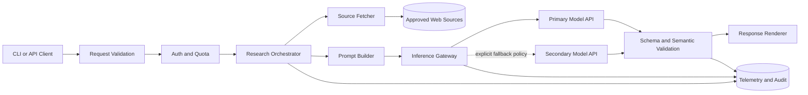

# Multi-provider LLM inference gateway

Status: In Review (Phase 1 case study). Design and implementation exercise only; no gateway is implemented.

[Phase 1](../../phases/phase-01-python-llm-foundations/README.md) · [System design path](../README.md)

## Requirements

### Functional

- Accept a company, optional source URLs, response schema version, and idempotency key.
- Validate and authorize the request.
- Route to a configured provider/model.
- Enforce timeout, output budget, and structured-output contract.
- Return the validated brief plus request ID, model identifier, prompt version, source records, latency, and usage where available.
- Support synchronous MVP execution; streaming is limited to plain-text preview, not final structured output.

### Non-functional

- p95 synchronous latency target: 15 seconds for the course MVP (measure; do not claim achieved until tested).
- No secrets or full sensitive payloads in logs.
- Bounded retries and concurrency.
- Traceable prompt/model/schema versions.
- Provider failure must not silently produce a fabricated success.

## Architecture

## Data flow

1. Validate company name, URL count, URL schemes, schema version, and output limits.
2. Authenticate caller; check quota before incurring provider cost.
3. Fetch only approved URLs with size/type/time limits; preserve failures explicitly.
4. Build a versioned prompt that treats fetched text as untrusted data.
5. Gateway selects an allowed model using capability/configuration, not ad hoc user choice.
6. Call with deadline and bounded transient retries; preserve provider request ID.
7. Validate JSON Schema/Pydantic, then semantic/evidence constraints.
8. Return success, partial-with-warnings, or typed failure; emit redacted telemetry.

## Storage and API decisions

- Phase 1 needs no database. Persist JSON artifacts locally for learning; later phases introduce PostgreSQL/vector storage.
- Proposed endpoint: `POST /v1/company-briefs`.
- Request fields: `company`, `source_urls[]`, `prompt_version`, `schema_version`, `idempotency_key`.
- Success: `brief`, `warnings[]`, `request_id`, `provider_request_id`, `model`, `latency_ms`, `usage`.
- Errors: `VALIDATION_ERROR` 400, `UNAUTHORIZED` 401/403, `RATE_LIMITED` 429, `UPSTREAM_TIMEOUT` 504, `MODEL_OUTPUT_INVALID` 502.
- Do not expose raw provider exceptions or keys.

## Scalability and capacity

- Maximum safe concurrency is constrained by provider requests/minute, tokens/minute, connection pool, and local memory.
- A rough tokens/minute estimate is `requests_per_minute × (average_input_tokens + average_output_tokens)`. Measure averages and apply headroom; do not assume every request hits its maximum.
- For higher load, place requests on a queue, use workers with per-provider semaphores, separate interactive and batch lanes, and implement admission control. Those are design extensions, not Phase 1 implementation requirements.

## Security

- Server-side keys only; secret manager in production.
- URL allowlist/SSRF defenses, download limits, and content-type checks.
- Fetched pages and invoice text are untrusted data and cannot override developer policy.
- Validate tool arguments and outputs; use least privilege.
- Redact logs; define retention; avoid sending confidential data to a provider without an approved data-processing policy.

## Failure scenarios and responses

- **429:** respect `Retry-After`, bounded backoff, then return typed rate-limit failure.
- **Timeout:** cancel upstream work; retry only within the overall deadline.
- **Invalid structured output:** one repair/retry using explicit error context if budget allows, otherwise fail visibly.
- **Partial source fetch:** return warnings and prohibit claims unsupported by available sources.
- **Provider outage:** use fallback only if explicitly configured, capability-compatible, and tested; record provider change.
- **Client retry:** idempotency key prevents duplicate billable work when cached result storage exists.

## Trade-offs

- Direct SDK integration is fastest; an internal gateway centralizes policy and telemetry but adds complexity.
- Multi-provider routing improves resilience/negotiation but increases behavioral variance and testing burden.
- Streaming improves perceived latency; buffering simplifies final schema validation.
- Rich logs speed debugging; data minimization reduces privacy risk.

## System-design interview exercise

Design this gateway for 100 requests/second across three regions with a 99.9% availability target. Explain admission control, quotas, provider routing, data residency, retries, observability, and how you prevent a provider outage from becoming a retry storm. State assumptions before calculating capacity.

## Submission and review

Submit a diagram, capacity assumptions, retry/deadline policy, failure table, redaction plan, and trade-off record. No SLO, resilience property, or deployment result is claimed as achieved. Idempotency storage, auth, provider fallback, and multi-region routing are design extensions, not Phase 1 code requirements.
