# Case study — Document ingestion and grounded knowledge retrieval

Phase 3 materials: In Review. Implementation, learner solution, deployments, and measured service properties: Planned.

## Architecture concepts and scope

Separate data ingestion from question serving, and treat provenance and generation compatibility as first-class contracts. The roadmap milestone is a local single-user knowledge assistant. This case study also discusses future service requirements, clearly distinguished from baseline capabilities.

## Functional requirements

- Accept approved PDF, DOCX, TXT, and CSV sources with stable IDs and versions.
- Parse/normalize content with format-appropriate locators and explicit conversion outcomes.
- Apply versioned chunk and encoder policies, then write a candidate Qdrant generation.
- Validate all required source/chunk/vector/locator invariants before activation.
- Retrieve evidence for a bounded question, assemble labeled context, generate and validate a cited response.
- Surface insufficient evidence, conflicts, and typed errors separately; support refresh/deletion of derived artifacts.

## Non-functional requirements and proposed targets

Keep the MVP small and reproducible: 12 curated sources, bounded chunks/token budgets, one active generation per request, deterministic ID policy, and redacted stage traces. A 10-second end-to-end answer target on a declared local workload is a design hypothesis for later measurement, not an achieved SLO. Parser/model downloads, OCR, or large documents can require a different budget. No availability or enterprise security claim is made.

## Mermaid architecture

```mermaid
flowchart LR
  F[Approved source files] --> V[Validate and version]
  V --> P[Format parsers and source quality checks]
  P --> N[Structured normalized blocks with locators]
  N --> C[Versioned chunks and final token validation]
  C --> E[Compatible embedding adapter]
  E --> W[Candidate Qdrant generation]
  W --> K[Count provenance and retrieval checks]
  K --> A[Active generation]
  Q[Question and trusted scope] --> R[Retrieve compatible evidence]
  A --> R
  R --> B[Deduplicate budget and label context]
  B --> G[Generator adapter]
  G --> J[Schema citation and evidence checks]
  J --> O[Answer or explicit non-answer with sources]
  P --> T[Redacted stage traces]
  R --> T
  J --> T
```

## Data flow and activation

1. Freeze approved source membership and hashes, including expected valid inputs.
2. Parse each source with versioned adapters; retain failure/partial/needs-review outcomes.
3. Normalize without erasing headings, row relationships, or source locators.
4. Split into bounded chunks; check final encoder input including contextual prefixes.
5. Encode with the active representation contract and write a fresh candidate collection/generation.
6. Validate required source coverage, counts, payload locators, vector schema, and smoke queries. Abort activation if required sources are incomplete.
7. Switch the application’s active-generation reference only after validation; current requests retain their chosen generation.
8. Retrieve candidates, build bounded evidence, call the generator, validate cited output, and render sources from the same source version.

## Storage and API decisions

The source manifest and normalized artifacts can be local JSON/files; Qdrant stores compatible vectors plus provenance payload. A relational database is optional, not mandatory. Use collection/generation metadata to avoid mixing incompatible embeddings or parser/chunker versions. Do not expose untrusted raw file paths or let arbitrary request parameters select hidden corpora.

Future `POST /v1/answers` accepts a bounded question and approved scope/generation policy. Result status distinguishes answered, insufficient evidence, conflict, and typed failure. Each claim carries supplied evidence-label references and each source record maps to original text/locators. Errors distinguish invalid request, parser/source failure, incompatible generation, unavailable retrieval, provider timeout/refusal, and invalid generated output.

## Capacity and scaling analysis

100 sources × 20 chunks/source × 384 float32 dimensions × 4 bytes = 3,072,000 bytes, about 2.93 MiB of raw vectors. This omits payloads, HNSW/payload indexes, model weights, parser state, candidate generations, and temporary arrays. A projected corpus of 10,000 sources at the same average chunk count has 200,000 vectors and about 292.97 MiB of raw vectors; it still says nothing directly about achieved latency.

Budget ingestion as parse + chunk + encode + write + validation. Budget question serving as query encoding + search + context construction + generation + validation. Bound batch/concurrency and use measured resource/latency distributions before adding queues or distributed workers. HNSW tuning, complex filtering, tenant isolation, and advanced retrieval depth belong to Phase 4/later operations material.

## Security and privacy

Local synthetic/licensed data is the baseline. Production intake would require authentication, authorization, content-type/size controls, parser isolation, and trusted corpus scoping. Retrieved source text is untrusted and must not redefine instructions or trigger tools. Keys and private payloads stay out of logs. Embeddings, chunks, caches, and retained generations inherit source sensitivity and deletion requirements. Prompt delimiters and valid citation IDs do not prove safety or factual support.

## Failure scenarios and recovery

- Corrupt or scanned source: explicit failure/needs-review; no empty-success source record.
- Oversized chunk: reject or apply a declared bounded fallback and revalidate before embedding.
- Incompatible collection/model: reject; build a compatible candidate rather than silently recreating shared data.
- Repeated ingestion: stable IDs and source/policy hashes avoid duplicates, while stale-tail cleanup remains explicit.
- Partial batch or source failure: keep candidate inactive; preserve the previous complete generation.
- Missing payload/locator: reject incomplete citation rendering rather than inventing page/source data.
- Empty/irrelevant context: return insufficient evidence; a provider outage remains an error.
- Unknown citation label: deterministic invalid-output failure; valid labels still need semantic support review.
- Source deletion: remove source-derived artifacts and expire retained generations under the stated policy.
- Framework upgrade: replay fixed evidence/parity fixtures before activating changed integration behavior.

## Observability and evaluation

Log safe source counts, parser/conversion outcomes, chunk counts, model/generation IDs, stage durations, retrieval IDs/scores, context size, output status, and error class. Keep raw sensitive text out by default. Separate parsing fidelity, retrieval evidence recall, context inclusion, claim support, citation integrity, and abstention diagnostics. A small test corpus is an instructional baseline, not proof of enterprise reliability.

## Architecture trade-offs

Manual orchestration improves visibility; framework adapters reduce boilerplate but add interface/version behavior. Structure-aware parsing improves provenance but adds dependencies and failure modes. More overlap/bigger context increases cost and repetition. Fresh generation activation simplifies consistency at extra storage cost. Query rewriting/hybrid retrieval/reranking may improve particular slices but add complexity and need separate controlled evidence.

## Interview exercise and review

Design ingestion for 10,000 office/PDF/CSV sources with daily updates and 20 simultaneous users. State average sizes/chunks, freshness, privacy, parser/OCR needs, generation-provider constraints, and quality targets before estimating capacity. Explain failure isolation, source deletion, compatible re-indexing, evidence tracing, and how a future authorization policy constrains retrieval. Separate the local baseline from production extensions; do not claim multi-tenancy is solved by a user-supplied metadata filter.

Submit a diagram, source/chunk/vector/answer contracts, capacity worksheet, activation/deletion plan, failure table, measurement/evaluation design, and trade-off record. Review against these requirements before any later implementation or deployment.
